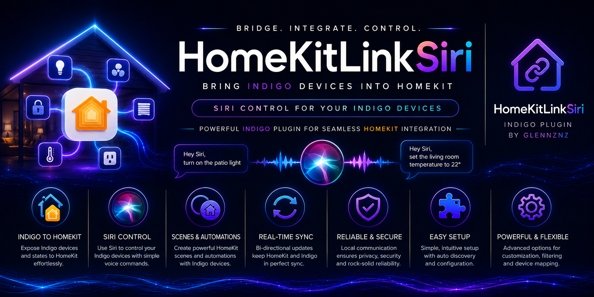
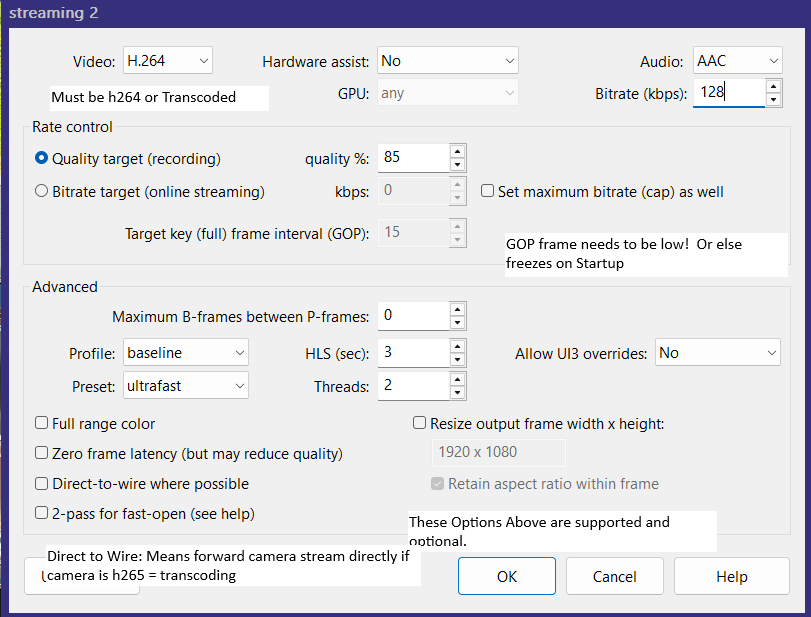

# Camera Setup

HKLS supports live camera streams from **Blue Iris**, **SecuritySpy** and **UniFi Protect** directly in the Apple Home app — including live video, Opus audio, doorbell notifications, and motion detection.

---

## Supported Camera Integrations

| System | Plugin Required | Video | Audio | Motion | Doorbell |
|---|---|---|---|---|---|
| **Blue Iris** | Blue Iris Indigo plugin | ✅ | ✅ Opus | ✅ | ✅ |
| **SecuritySpy** | FlyingDiver SecuritySpy plugin | ✅ | ✅ Opus | ✅ | ✅ |
| **UniFi Protect** (v0.8.12+) | Durosity UniFi plugin, or kw123 uniFiAP plugin | ✅ | ✅ Opus | ✅ | ✅ |
| Other cameras | — | ⚠️ Limited | ❌ | ❌ | ❌ |

> **Other cameras** are not officially supported. For unsupported camera systems, consider running a separate [Homebridge](https://homebridge.io/) instance with an appropriate camera plugin.

---

## Prerequisites

### Blue Iris
1. Install the **Blue Iris** Indigo plugin — HKLS pulls camera info and RTSP URLs from it
2. Configure your BI cameras with RTSP stream access on a reachable URL
3. Install the Blue Iris plugin and ensure BI cameras appear in Indigo

### SecuritySpy
1. Install **FlyingDiver's SecuritySpy** Indigo plugin
2. Configure SecuritySpy cameras to have RTSP access

### UniFi Protect
Either plugin works — see [UniFi Protect](#unifi-protect-v0812) below.

---

## Adding a Camera to a Bridge

1. Open the HomeKitLink Bridge config dialog
2. In the device filter, select **Cameras**
3. Select your BI or SecuritySpy camera device from the list
4. Select HomeKit type: **Camera** (auto-detected for camera devices)
5. Configure the options that appear:
   - **Doorbell device** — optional: select any on/off Indigo device; when it turns on, HomeKit fires a doorbell notification with live video
   - **Motion sensor** — BI cameras automatically register as HomeKit motion sensors
6. Click **Save Device** then **Save** in the dialog

---

## Blue Iris Stream Settings

HKLS uses **Stream 2** from Blue Iris for HomeKit. Optimal settings for zero-transcoding passthrough:



### Recommended Profile 2 settings:
- **Codec:** H.264 (Constrained Baseline, level ≤ 4.0 ideal)
- **Pixel format:** yuv420p
- **GOP:** Keep low (≤ 2 seconds between keyframes)

> **Tip:** After changing Blue Iris stream settings, run **Plugins → HomeKitLink Siri → Check or Update Camera Streams for Compatibility** to update how HKLS processes the stream.

---

## Remote / Mobile Viewing — Blue Iris (v0.8.09+)

At home on Wi-Fi the Home app asks for about **1280×720 at 299 kbps**. HKLS sends Stream 2 straight through at full camera resolution, which works well on a local network.

Away from home (mobile data, 5G, or another Wi-Fi) the stream goes via your **Home hub** (Apple TV / HomePod), and the Home app asks for something much smaller, typically **640×360 at 132 kbps**. A Stream 2 set to *Direct-to-wire* can't do that: Blue Iris passes the camera's own stream untouched and ignores the requested size and bitrate (for example 4K at 25 Mbps, around 190× too much). The stream fails to start or stalls.

So for remote requests (under 1280 wide or under 299 kbps) HKLS uses a **second Blue Iris stream** that Blue Iris re-encodes, asking for exactly the size and bitrate HomeKit wants (`&h=` and `&kbps=`). At-home viewing is unchanged.

### Set up the remote stream in Blue Iris

Blue Iris has three encoder profiles (Stream 0, 1, 2), all user configurable in **Settings → Web server → Advanced → Encoding**. Use one that is not Stream 2 (Stream 0 by default) and set it to:

| Setting | Value | Why |
|---|---|---|
| **Video** | H.264 | HomeKit doesn't support H.265 |
| **Direct-to-wire** | **Off** | Direct-to-wire can't resize or limit bitrate |
| **Rate control** | **Target bitrate** (not quality) | Quality-based profiles ignore `&kbps=` (seen: 1–2.5 Mbps when 132k was asked for) |
| **Frame type layout / keyframe interval** | 15–30 frames at 15 fps (a keyframe every 1–2 s) | HomeKit needs frequent keyframes to start the stream |
| **Profile / preset** | Main, superfast, zero frame rate latency | The Blue Iris defaults, lowest delay |
| **Resize** | Not needed | HKLS asks for the size per request |

Then choose that stream in **Plugin Config → BlueIris Remote Viewing Stream** (Stream 0 default, Stream 1, or Off) and restart the plugin.

### Startup check

When the plugin starts, each Blue Iris camera's remote stream is tested at 360p / 132 kbps for a few seconds. The plugin only uses it if Blue Iris really resizes it and holds the bitrate:

```
[Camera] Remote viewing: ✓ BlueIris Stream 0 resizes and limits bitrate (640x360, 144k when 132k asked for).
```

If not, a warning names the setting to fix, and remote viewing for that camera stays on Stream 2:

```
[Camera] Remote viewing: BlueIris Stream 1 ignores the bitrate HomeKit asks for (1698k when 132k asked for). ...
```

When a remote stream starts you'll see:

```
[Camera] Remote / low-bandwidth request (640x360 @ 132k): using BlueIris Stream 0 (re-encoded by BlueIris)
```

---

## UniFi Protect (v0.8.12+)

UniFi Protect cameras and doorbells are published from the cameras another Indigo plugin creates. Choose **UniFi Protect Camera** in the bridge's device filter.

| | Durosity **UniFi** plugin | kw123 **uniFiAP** plugin |
|---|---|---|
| Camera device | *Protect Camera* | *Camera_Protect_…* |
| Live video | ✅ from the plugin's RTSP streams | ✅ from the **Stream URL** you paste in |
| Away from home | Low stream, re-encoded to what HomeKit asks for | Same stream as at home |
| Snapshots | ✅ | ✅ |
| Motion (incl. person / vehicle) | ✅ | ✅ |
| Doorbell | ✅ automatic for UniFi doorbells | ✅ automatic for UniFi doorbells |
| Two-way audio (talk) | ✅ v0.8.17+, opt-in | ❌ |

### Durosity UniFi plugin
1. Run the UniFi plugin action **Enable RTSP Streaming** for each camera, with **High** and **Low** ticked
2. Publish the camera — leave **Stream URL** blank

### kw123 uniFiAP plugin
1. In Protect, open the camera → **Settings → Advanced → RTSP**, turn on **High** and copy its URL (`rtsps://…:7441/…`)
2. Publish the camera and paste the URL into **Stream URL**

### How it streams
- **At home:** the High stream is passed straight through when it suits HomeKit (Medium is used if High is larger than 1920 wide)
- **Away from home:** the Low stream (~640×360) is re-encoded to the bitrate HomeKit asks for. This only runs while you are watching
- A camera whose model is a doorbell gets the HomeKit doorbell automatically; other cameras can still use **DoorBell Linked**

### Two-way audio (v0.8.17+)
Talk from the Home app through a UniFi doorbell or a camera with a speaker (UniFi plugin by Durosity only).
1. In the camera's HomeKitLink settings, turn on **Support Audio** and **Two-way Audio (talk)**
2. Save, then restart the bridge — the Home app shows the talk button on the camera

While you talk, the camera's own audio is muted so your voice doesn't echo back. The log shows:
```
Two-way audio: talking to Front Door (opus, 24000 Hz, …)
Two-way audio: finished, 412 packets sent to Front Door
```
If talk doesn't work you'll see a warning instead, for example `couldn't open a Protect talkback session` (check the UniFi plugin's API key).

### Startup check
```
[Front Door] ✓ UniFi remote viewing: Low stream 640x360 h264 (re-encoded to the bitrate HomeKit asks for)
[Front Door] No UniFi Low stream - away from home the full stream will be used, which may not play on mobile data. Enable the Low RTSP stream for this camera.
[Front Door] UniFi camera has no stream URL - run the UniFi plugin action 'Enable RTSP Streaming' for this camera (High and Low).
```
Stream URLs are shown as `rtsps://host:7441/****` in the log — the end of the URL lets anyone watch the camera, so keep it private.

---

## Camera Stream Intelligence (v0.7.25+)

HKLS now includes automatic stream compatibility checking via `ffprobe`:

### How It Works
At startup, HKLS silently analyses every configured camera stream. Based on the results:
- **H.264 + yuv420p + compatible GOP** → stream is passed through unchanged (zero transcoding, lowest CPU)
- **Incompatible codec / pixel format / GOP** → HKLS auto-transcodes the stream to H.264 for HomeKit

### Check Camera Streams Manually

Run: **Plugins → HomeKitLink Siri → Check or Update Camera Streams for Compatibility**

Example output:
```
HomeKitLink Siri   [Deck Camera]   Video: codec=h264  profile=Constrained Baseline  pix_fmt=yuv420p  2688x1520 @ 15.0 fps
HomeKitLink Siri   [Deck Camera]   GOP: 15 frames (1.1s between keyframes)
HomeKitLink Siri   [Deck Camera]   ✓ H.264 + yuv420p — safe for copy/passthrough.
HomeKitLink Siri   [Deck Camera]   Config: video_codec=copy — passthrough active. Good.
HomeKitLink Siri   [Deck Camera]   Audio: codec=aac  rate=64000  channels=1
HomeKitLink Siri   [Deck Camera]   Config encoder: libopus — will transcode from aac.
```

> **Run this after any Blue Iris stream setting change.** It updates HKLS's internal decision on whether to passthrough or transcode.

---

## Opus Audio (v0.7.10+)

### The Problem
FFmpeg uses 48 kHz timestamps for Opus audio (per RFC 7587), but HomeKit expects the negotiated clock rate (e.g. 16 kHz). This mismatch caused silent or distorted audio.

### The Solution — Audio Proxy
HKLS includes a native **homekit_audio_proxy** — a subprocess-based RTP/SRTP audio proxy that:
1. Receives plain RTP from FFmpeg
2. Converts timestamps from 48 kHz to HomeKit's expected rate
3. Encrypts with SRTP (AES_CM_128_HMAC_SHA1_80)
4. Forwards to the HomeKit client

The result is **near-perfect audio quality** in the Home app.

### Blue Iris Cameras
BI cameras default to **libopus** for audio encoding. After enabling this feature, cameras must be **removed from Home and re-added** so the Home app can reassess the audio stream.

### SecuritySpy Cameras
SecuritySpy cameras gain the same libopus audio proxy support.

### Remote viewing audio (v0.8.10+)
Away from home the Home app asks for longer audio packets (60 ms instead of 20 ms). At 60 ms an Opus packet can be bigger than the old 188-byte audio packet size (seen: 257 bytes), which stopped ffmpeg's audio output. The video kept playing and the volume control showed, but there was no sound. HKLS now sizes audio packets to the negotiated packet time; at-home (20 ms) audio is unchanged.

The audio proxy also now forwards audio **RTCP** sender reports (encrypted as SRTCP, on the same port as the audio, as HomeKit expects). Before, only the audio packets themselves were sent.

---

## Doorbell Integration

Any HKLS camera can have a **Doorbell** device associated with it:

- Select any on/off Indigo device as the doorbell trigger
- When that device turns **on**, HomeKit fires a doorbell notification
- The notification shows the **live camera stream** — tap to view the feed
- Works great with smart doorbells, button devices, or motion-triggered relays

---

## HomeKit Secure Video (v0.8.22+)

HomeKit Secure Video (HKSV) lets your home hubs record a camera's motion and doorbell events to iCloud, with the Home app's timeline, face recognition and activity zones. It is **per camera and opt-in**: cameras without an HKSV Recorder device are unchanged.

> HKSV is here thanks to **Durosity**, whose PR #42 worked out the HomeKit recording services and the encrypted HomeKit Data Stream they use. HomeKitLink's version builds on that work, with the changes described under [Approach and costs](#approach-and-costs).

### What you need
- The **home owner** needs an iCloud+ plan. Without one the Home app shows no Recording Options. The plan sets how many cameras can record: 1 on 50 GB, 5 on 200 GB, unlimited on 2 TB and up
- A home hub: Apple TV or HomePod
- The camera published by HomeKitLink, with its **motion sensor** turned on

### Add a recorder
1. **Plugins → Devices → New Device**, type **HomeKit Secure Video Recorder**
2. Choose the camera, then Save
3. HomeKitLink restarts that camera's bridge to add the recording services
4. **If Recording Options don't appear** (or recordings don't show on an iPhone), the Home app is still using what it knew about the camera:
   - first, **force-close the Home app** (swipe it away) on each iPhone/iPad and open it again. The Home app should then show a "Secure Video" welcome for the camera
   - if that doesn't do it, **re-add the camera**: unpublish it from its bridge, save, wait for it to disappear from the Home app, then publish it again. Only that camera is affected (its room, name, notifications and automations need setting again); the bridge doesn't need re-pairing
5. In the Home app, open the camera's settings → **Recording Options**, and choose when to record (e.g. Stream & Allow Recording when away). The Home app may say "There was an error updating the setting" the first time; the setting is saved regardless

### How it records
HomeKit wants each recording to start a few seconds **before** the motion, so while the Home app allows recording, one ffmpeg keeps the last few seconds of the camera in memory (the prebuffer). It only runs while recording is allowed: if the Home app is set to Stream or Off (for example while you're home), nothing runs.

At bridge start the Recorder checks each of the camera's streams (BlueIris streams 0–2, UniFi High/Medium/Low, SecuritySpy) and logs one line per stream:
```
[Gate Cam] HKSV stream check - BlueIris stream 0: h264 1912x1080 @ 11.2 fps, Main 4.0, keyframe every 2.7 s - copy OK, aac 64000 Hz
[Gate Cam] HKSV stream check - BlueIris stream 2: h264 2688x1520 @ 11.8 fps, Constrained Baseline 5.1, keyframe every 1.4 s - can't copy: 2688x1520 is larger than 1920x1080, aac 64000 Hz
```
A stream is **copied** (no re-encoding, about 1–2 % CPU) when it is H.264, at most 1920×1080 and level 4.2, at most 30 fps, with a keyframe at least every 4 seconds. Otherwise the best stream is **re-encoded** to the format the hub chose, with VideoToolbox by default (measured 6–10 % CPU and ~150 MB for 1080p). Audio is always converted to AAC-LC, which costs very little.

> To let a BlueIris camera be copied, give one of its streams (often stream 0) a size of 1920×1080 or less, a **fixed** frame rate (e.g. 15 fps) and a keyframe interval of 4 s or less. A stream whose frame rate drops (e.g. at night) also stretches the time between keyframes, so it may copy at one bridge start and re-encode at the next.

### Approach and costs
HKSV is built very differently from live view, and that is why it is opt-in per camera.

**Why it can't simply use the live stream.** Live view only runs while someone is watching. HKSV recordings must start a few seconds **before** the motion that triggers them, so the camera has to be watched all the time while recording is allowed, keeping the last few seconds in memory. When the home hub sees motion, it opens an encrypted HomeKit Data Stream to the plugin and asks for the recording: the plugin sends those seconds, then the live video, until the motion has stopped. The hub then analyses the clip (people, animals, vehicles, faces) and stores it in iCloud.

**What HomeKitLink does to keep that cheap:**
- **One camera at a time, by choice.** Only cameras with a Recorder device get the recording services; nothing changes for the rest.
- **Copy before re-encode.** Each of the camera's streams is checked once at bridge start; if one already suits HomeKit it is passed through untouched. PR #42 always re-encoded.
- **Only while needed.** The prebuffer runs only while the Home app allows recording for the camera (and the Recorder is enabled). With "Stream" when home and "Stream & Allow Recording" when away, nothing runs while you're home.
- **Measured, not guessed.** The Recorder shows its ffmpeg's actual CPU, memory and data rate, so you can see the cost of each camera.

**Measured with one 1080p BlueIris camera** (re-encoding to the 1920×1080 the hub asked for, on an Intel i7-8700B Mac mini):

| | CPU (of one core) | Memory | Network (from the NVR) |
|---|---|---|---|
| Copy | ~1–2 % | ~20–35 MB | the stream's own rate, ~0.5–1 Mbps |
| Re-encode, VideoToolbox | ~13 % | ~150 MB | the source stream's rate |
| Re-encode, libx264 | ~65 % | ~165 MB | the source stream's rate |

VideoToolbox is about five times cheaper than libx264 here. Apple Silicon Macs encode H.264 in a dedicated media engine, so VideoToolbox should be cheaper still there — check the Recorder's `ffmpegCpuPercent` on your own Mac. These costs apply **all the time** while recording is allowed, not just while recording.

**Risks with many cameras.** Every Recorder camera adds, continuously:
- **one more connection to the NVR** (BlueIris, SecuritySpy or Protect), on top of its own recording and any live viewers. NVRs and some cameras limit simultaneous streams;
- **one more ffmpeg** in the Indigo Mac, with the CPU and memory above. Ten copied cameras is modest; ten re-encoded ones is a real load, and VideoToolbox has a limit on simultaneous hardware sessions;
- **a constant stream over the network** if the NVR is on another machine;
- **more work for the home hub**, which analyses every motion clip from every camera. An Apple TV or HomePod handling many busy cameras becomes the bottleneck;
- **iCloud limits**: 1 camera on 50 GB, 5 on 200 GB, unlimited on 2 TB and up;
- **the same footage recorded twice** — once by your NVR, once in iCloud.

**Recommendations**
- Start with one or two cameras where it matters (the front door, a doorbell, so the rest of the family can see clips), and watch the Recorder's CPU and memory.
- Make sure those cameras **copy**: give the NVR stream used a size of 1920×1080 or less, a fixed frame rate and a keyframe every 4 s or less. Check `recordMode` and `streamCheck`.
- Use the Home app's modes so recording is only allowed when it's useful (e.g. when away).
- Prefer the NVR's own recording and alerts for everything else.

**Known limitations**
- Tested with BlueIris and an Apple TV hub. SecuritySpy and UniFi Protect use the same code with their own streams, but haven't yet been tried with a real hub.
- A camera whose keyframe interval varies (BlueIris re-encoded streams at a variable frame rate) may copy at one bridge start and re-encode at the next.
- The stream check takes about 10–15 s per stream at bridge start; recording can't start before it finishes.

### The Recorder device
| Setting | |
|---|---|
| **Copy a suitable stream** | On by default. Turn off to always re-encode |
| **When re-encoding, use** | VideoToolbox (Mac hardware, low CPU) or libx264 (software, high CPU) |
| **Disable** (Enable/Disable communication) | Stops recording and the prebuffer. The camera keeps its Home app recording settings |
| **Delete** | Removes HKSV from the camera (its bridge restarts) and forgets its Home app recording settings |

| State | Meaning |
|---|---|
| `status` | Disabled, Camera off in Home app, Recording off in Home app, Waiting for hub, Checking streams, Buffering (copy/transcode), Recording, or Can't record |
| `streamCheck` | Each stream's size and whether it can be copied |
| `recordSource`, `recordMode`, `recordModeReason` | The stream being recorded, copy or transcode, and why |
| `ffmpegCpuPercent`, `ffmpegMemoryMB`, `prebufferKbps` | The recorder ffmpeg's CPU, memory and data rate (updated every 30 s) |
| `prebufferSeconds`, `ffmpegRestarts`, `lastError` | Seconds held in memory, ffmpeg restarts, and the last problem |
| `recordingsToday`, `lastRecordingStart`, `lastRecordingSeconds`, `lastRecordingMB` | Recordings sent to the hub |
| `homeAppCameraOn`, `homeAppRecording`, `homeAppRecordingAudio` | The camera's switches in the Home app |
| `selectedConfig` | The recording format the hub chose |
| `hubsConnected`, `lastHubContact` | Home hubs connected to the camera's data stream |

In the log, look for `hub chose …`, `prebuffer started - …`, `recording to hub …` and `recording finished - … s, … MB`. Turn on **12. Debug HomeKit Secure Video** in the plugin Config for more detail.

---

## Camera Performance Tuning

Configure camera performance in **Plugin Config** (Plugins → HomeKitLink Siri → Configure…):

| Setting | Default | Effect |
|---|---|---|
| Camera Max Refresh Time | 30s | Max rate at which HKLS delivers images to Home. Lower = more CPU/network |
| Passive Camera Update Time | 1 hour | How often HKLS refreshes the image buffer when Home is not watching |
| Image Width | — | Width of snapshot images |

---

## Debugging Camera Issues

### Rerun FFmpeg Command for Logging

**Plugins → HomeKitLink Siri → Rerun Ffmpeg Call for Logging**

Replays the last camera stream command and logs the full FFmpeg output. Use this to identify:
- RTSP URL problems
- FFmpeg codec errors
- Authentication failures

### Debug Level 7

Enable **Debug 7 — Camera** in Plugin Config for verbose camera stream logging.

### Common Camera Issues

| Symptom | Likely Cause | Fix |
|---|---|---|
| Black screen in Home | RTSP URL unreachable | Check BI/SS is running; test URL in VLC |
| Audio missing or distorted | Old camera not re-added after Opus update | Remove camera from Home, re-add via QR code |
| High CPU usage | Stream requires transcoding | Fix BI Profile 2 settings for H.264 passthrough |
| Camera not appearing in list | BI/SS plugin not installed or camera not configured | Install respective plugin, configure cameras |
| Stream check shows "borderline GOP" | GOP too large | Reduce keyframe interval in BI Profile 2 |
| Works on Wi-Fi but not on mobile data | Stream 2 is Direct-to-wire (full camera resolution / bitrate) | Set up a remote stream — see [Remote / Mobile Viewing](#remote--mobile-viewing--blue-iris-v0809) |
| Remote video works but no sound | 60 ms audio packets too big (before v0.8.10) | Update to v0.8.10+ |
| Startup warning "Remote viewing: … did not resize / ignores the bitrate" | Remote stream is Direct-to-wire or quality based | Change that Blue Iris stream's settings, or pick another in Plugin Config |

---

→ [Plugin Menu Items](Plugin-Menu-Items) — all menu tools explained
