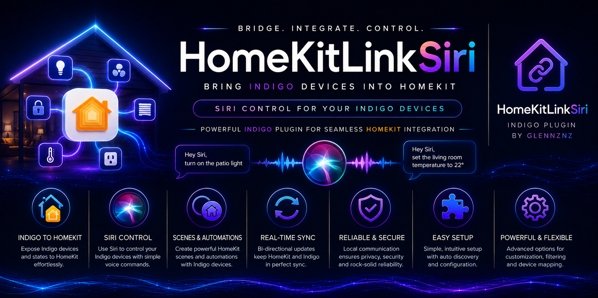

# Changelog

Complete version history for HomeKitLink Siri.

---

## 0.8.18 — 2026-11-14

### 🎙️ UniFi Protect two-way audio fixes
- The camera's sound no longer freezes when you start talking: the Protect talk session now opens in the background, even if the console is slow to answer
- When HomeKit uses longer audio packets (often away from home), the camera's sound is now muted cleanly while you talk, instead of glitching

---

## 0.8.17 — 2026-11-11

### 🎙️ UniFi Protect two-way audio
- Talk from the Home app through UniFi doorbells and cameras with a speaker (UniFi plugin by Durosity)
- Turn on **Two-way Audio (talk)** in the camera's HomeKitLink settings; Support Audio must be on
- The camera's own audio is muted while you talk, to stop your voice echoing back
- Based on the two-way audio in PR #42 (thanks Durosity)

---

## 0.8.16 — 2026-11-11

### 📷 Camera snapshots
- Fixed camera tiles showing the default images for several minutes after the plugin starts. The startup camera stream check now runs on its own, so snapshots are fetched straight away
- Shorter mDNS start-up debug line per bridge

---

## 0.8.15 — 2026-11-11

### 🏠 HomeKit library updates (part 2)
- **Fewer Home app reloads:** a bridge's accessory list is no longer treated as changed just because a device's value changed, so the Home app stops re-downloading every bridge after most plugin restarts. Expect one final reload after updating
- **Camera snapshots:** a request arriving while a snapshot was being fetched closed the connection and lost the snapshot; requests and updates now wait their turn
- Faster bridge start-up: device values are no longer read just to check for changes

---

## 0.8.14 — 2026-11-11

### 🔒 HomeKit library updates
Fixes and hardening brought in from the current HAP-python library:
- **Pairing:** an unpaired bridge can no longer be paired without the setup code by a specially crafted request; malformed pairing data is rejected; after 5 wrong setup codes, pairing pauses for 60 seconds
- **Cameras:** snapshots are only sent to paired Home devices; the stream address from the Home app is checked before it's used
- **Fixed:** camera or pairing data of certain lengths could be corrupted; a closed connection was treated as an error; oversized requests are refused
- **Faster:** less copying when sending and receiving HomeKit data

---

## 0.8.13 — 2026-11-11

### 📷 UniFi Protect logging
- Each UniFi camera logs its setup at start-up: plugin, model, streams found, doorbell, motion and audio
- Snapshot problems are logged once with the reason (e.g. HTTP 401 - check the controller's API key), and again when they recover
- Doorbell rings are logged
- Stream URLs are masked in all log lines

---

## 0.8.12 — 2026-11-11

### 📷 UniFi Protect cameras
- New camera type **UniFi Protect Camera**, for cameras from the Durosity UniFi plugin or kw123's uniFiAP plugin
- Live video, snapshots, Opus audio, motion and doorbell; away from home the Low stream is re-encoded to the size HomeKit asks for
- New camera auto-detect picks the right camera type (also fixes SecuritySpy cameras defaulting to Blue Iris)
- See [Camera Setup → UniFi Protect](Camera-Setup#unifi-protect-v0812)

---

## 0.8.11 — 2026-11-11

### 🛠️ Fixes (thanks to Durosity, PR #42)
- Garage doors: start-up target state is now always open or closed
- Cameras: a stream stopped by the Home app while still starting no longer leaves ffmpeg and the audio running
- No more errors when the Home app asks for an accessory that was just unpublished
- Unpublishing a device is more reliable
- Clearer log message when a camera stream has no video
- Removed unused code

---

## 0.8.10 — 2026-11-10

### 📷 Blue Iris remote / mobile camera viewing
- Away from home, cameras now use a Blue Iris stream re-encoded to the size and bitrate HomeKit asks for (e.g. 640×360 at 132 kbps), instead of the full-resolution Stream 2. At-home Wi-Fi viewing is unchanged
- New Plugin Config option **BlueIris Remote Viewing Stream** (Stream 0 default, Stream 1, Off)
- Each camera's remote stream is checked at startup; if Blue Iris doesn't resize it, a warning explains what to change
- See [Camera Setup → Remote / Mobile Viewing](Camera-Setup#remote--mobile-viewing--blue-iris-v0809)

### 🔊 Remote viewing audio
- Fixed no sound away from home: the longer audio packets HomeKit asks for remotely were too big and stopped the audio
- Audio RTCP sender reports are now sent to HomeKit (SRTCP)
- Negotiated audio settings are now included in the camera debug log

---

## 0.8.08 — 2026-11-10

### 🔐 New: Troubleshoot 4 — HomeKit Pairing & Security Keys
- New menu item that checks each bridge's pairing and security keys, Home users and connected Home hubs
- Clear ✅ / ⚠️ / ❌ result per bridge, a fix for each problem, and a guide to common HomeKit issues
- See [Plugin Menu Items](Plugin-Menu-Items) for details

### 📱 New: Show QR Code page
- QR code, setup code, pairing status and step-by-step instructions

### 🐛 Bug fixes
- Plugin could fail to load (stray `scipy` import)
- Battery levels now update in HomeKit
- Thermostat setpoints, security system startup state and Paradox arm/disarm
- Camera stream stability and clean-up
- Move Accessories, several crashes, Toggle Debug remembers its level
- Clearer log message when a Home app device can't connect to a bridge
- Removed the hidden legacy "unQuarantine files" option
- Typo and wording fixes

---

## 0.8.05 — 2026-04-07

### 🎵 Major: Camera Audio — Opus SRTP Proxy
- New **homekit_audio_proxy** library — a subprocess-based RTP/SRTP audio proxy solving the FFmpeg/HomeKit clock-rate mismatch for Opus audio
- FFmpeg uses 48 kHz timestamps (RFC 7587) but HomeKit expects the negotiated rate (e.g. 16 kHz). The proxy receives plain RTP from FFmpeg, converts timestamps, encrypts with SRTP (AES_CM_128_HMAC_SHA1_80), and forwards to the HomeKit client
- Blue Iris cameras default to **libopus** for audio
- SecuritySpy cameras gain the same libopus audio proxy support
- **⚠️ Breaking:** Existing cameras must be removed from Home and re-added for the Home app to reassess the audio stream. Results in significantly better audio quality

### 🎥 Major: Camera Stream Intelligence
- New `resolve_video_strategy()` function — uses `ffprobe` data to intelligently decide whether to copy or transcode each camera's video stream
- New Menu Item: **"Check or Update Camera Streams for Compatibility"** — runs ffprobe against all cameras and logs compatibility findings
- Auto-runs at startup in debug-only mode
- Automatic transcoding — when ffprobe detects incompatible streams (non-H.264, wrong pixel format, problematic GOP), HKLS auto-transcodes for HomeKit compatibility
- Updated `homekitlink_ffmpeg` library to include ffprobe binaries

### 🌐 Major: mDNS/Zeroconf Refactor
- Default IP version changed to **V4Only** (was All) — the HAP server is fundamentally IPv4-only; IPv6 mDNS served no purpose
- New `zeroconf_interfaces` parameter separates "which interfaces zeroconf listens on" from `interface_choice` (ip_version) — properly treated as mutually exclusive
- Fixed `advertised_address` conflation bug — was incorrectly passed as `interfaces` to AsyncZeroconf
- **mDNS Interfaces field unhidden** in Plugin Config — now visible under Advanced settings
- Auto-derive interfaces from server IP — when HAPServerIPAddress is set but mDNSInterfaces is empty, interface list auto-derived as `[HAPServerIPAddress]`

### 🔍 Major: Diagnostic & Troubleshooting Tools
- New Menu Item: **"ℹ️ Troubleshoot 2 — Network Trouble Shooting"** — comprehensive network diagnostic including LNA test, multicast, UDP, gateway, firewall, plugin config, port checks, DNS
- Definitive LNA test: uses `IP_MULTICAST_IF` bound to a non-loopback IP + sendto() to mDNS group — catches the exact failure mode when LNA is blocked
- New Menu Item: **"ℹ️ Troubleshoot 3 — Support mDNS Troubleshooting"** — mDNS/Bonjour diagnostic
- Enhanced **"Troubleshoot 1 — Support Information"** — now includes mDNS/network configuration details

### 🐍 Python 3.13 Compatibility
- Removed `async_timeout` dependency — replaced with Python 3.11+ built-in `asyncio.timeout`
- Updated libraries: `cryptography` 41→46, `orjson` 3.8→3.11, `h11` 0.14→0.16, `zeroconf` 0.131→0.148, `chacha20poly1305-reuseable` 0.12→0.13
- Removed `slugify` and `aiofiles` dependencies
- Added `cffi`, `pycparser`, `ifaddr` as explicit dependencies
- Fixed pip install success detection — glob matching for Python-version-prefixed filenames

### 🐛 Bug Fixes
- Removed dead `cryptography` import check — handled by preflight
- Fixed image snapshot timeout issue (from 0.7.02)
- Fixed interfaces not being selectable in plugin config (from 0.7.40)
- Fixed multi-NIC discovery — binding to all IPv4 interfaces fixes issues with 2+ active network connections

---

## 0.7.50

- Unhide mDNS zeroconf server address selection in Plugin Config (was previously hidden with `hidden="true"`)

---

## 0.7.45 – 0.7.46

- Fine tuning to support logging output
- mDNS refactor: IPv4 default for all users
- Plugin Menu: Support Logging Info improvements
- Bug fix: interfaces not being selectable in plugin config
- Bind to all IPv4 interfaces (fixes issues when 2 or more network connections are active)
- Logging changes and improvements

---

## 0.7.40

- Refactor mDNS — IPv4 default for all users
- Add Plugin Menu: Support Logging Info item
- Bug fix: interfaces not being selectable in plugin config
- Bind to all IPv4 interfaces (should fix issues when 2+ network connections active)
- Logging improvements

---

## 0.7.30

- **Major: Blue Iris camera stream intelligence** — checks streams and decides best passthrough vs. transcode approach
- New Menu Item: **"Check or Update Camera Streams"** — run after modifying Blue Iris web server settings
- Automatic transcoding when incompatible streams are detected
- Added image for optimal Blue Iris Profile 2 settings
- Updated `homekitlink_ffmpeg` library to include `ffprobe` binaries (published to PyPI)

---

## 0.7.15

- Add audio proxy and libopus support for **SecuritySpy** cameras

---

## 0.7.10

- **Major: Opus audio proxy** — solves FFmpeg/HomeKit clock-rate mismatch
- Blue Iris cameras default to libopus audio (requires camera re-add in Home app for existing setups — delivers much better audio quality)
- Fix for logging menu item compatibility with new Python changes

---

## 0.7.02

- Fix for image snapshot timeout failure
- Changed pip success detection to work with new Python version filename format

---

## 0.7.01

- Changed pip success library checking to manage new Python version
- Library updates and deletions
- Removed `async_timeout` dependency
- Updated all libraries to latest compatible versions

---

## 0.6.76

- Update zeroconf to version 0.146

---

## 0.6.75

- **Support for FlyingDiver's SecuritySpy plugin** — enables SecuritySpy camera types in HKLS
- Few bug fixes for deleting bridges without restarting
- Add support for **Motion Events** from SecuritySpy (was not an option previously)
- Add support for **Doorbell** and trigger on doorbell press (Home app shows pop-up video notification)

---

## 0.6.74

- Support for FlyingDiver's SecuritySpy plugin (initial commit, fine tuning)

---

## 0.6.73

- Add check for missing deviceID — prevents crashes when device references are stale

---

## 0.6.40

### Camera Handling Updates
- Refactor FFmpeg and camera handling — BlueIris working well
- Use TCP for `rtp_transport` — avoids errors and slight slowdown from FFmpeg UDP
- Speed up stream checks and closing unnecessary streams
- Attempt to fix OS 17.2 AppleTV issue where it opens all camera streams simultaneously

### New Camera Settings
- **Camera Max Refresh Time** — sets maximum refresh interval per camera; Home app requests are throttled to this rate
- **Passive Camera Update Image Time** — controls how often HKLS updates the stored image buffer when Home app is not actively viewing
- **Image Width** setting

---

## 0.6.0

### New HomeKit Architecture (iOS 16.4)
- After iOS 16.4, the Home app may close/reopen connections more aggressively without a Home Hub — this is normal; a Home Hub eliminates this behaviour
- Spins up HKLS's own Zeroconf async server shared by all bridges, minimising overhead
- Adds Advanced mDNS Options in Plugin Config
- Adds **Reset Accessory / Bridge** menu item
- Bump python-zeroconf to 0.56
- Bump h11 to latest dev version
- Adds debug10 logging for very verbose mDNS (file only)
- Attempt to fix Valve/Irrigation/ShowerHead devices — resolved
- Add HKLS support for AD2USB security systems (beta, thanks ab39870)

---

## 0.3.3

- Use `address` if `xaddress` is not available in SecuritySpy cameras

---

## 0.3.2

- Bug fixes for Thermostat device handling
- Fix leftover Fahrenheit → Celsius conversion issue
- Manage SetpointHeat/SetpointCool independently when mode changes
- Updated VSS security system state mapping

---

## 0.2.31

- Reject non-camera devices when trying to configure camera type
- **Security System support** — Paradox/Magellan/SP7000, VSS, DSC Keypad

---

## 0.2.29

- Add support for **Window** accessories

---

## 0.2.28

- **Battery Service** added to all sensor types
- **Low Battery Alert** threshold setting in Plugin Config
- **Window Blinds** support with position (0–100%) and inverse control options

---

## 0.2.24

- Dual binary FFmpeg supporting both M1 (Apple Silicon) and x86 Macs
- Support for MultiIO Garage Door (Insteon) devices
- Fix for empty pluginProps integer conversion

---

## 0.2.19

- **Locks** — lock/unlock control and state reporting
- **Garage Doors** — open/close control
- **Fan** (simple) and **Fan V2** — plugin auto-selects subtype; SpeedControl devices → Fan V2

---

## 0.2.17

- Camera thread exception fix — keep running regardless of single stream failures
- Move to explicit accessory subtypes per HomeKit device (Lightbulb, Lightbulb_switch, etc.)
- Simplified setter and deviceUpdated logic

---

## 0.2.16

- **Move Accessories to another Bridge** menu item — enables recovery if bridge was deleted
- Redo "Log all Devices" — shows missing and disabled bridge devices
- Fix for Lightbulb misspelling causing brightness issues
- Fix for RGB/Temperature lights all defaulting to Lightbulb type
- Fix for Saturation occasionally not being sent when value is 100

---

## 0.2.15

- Typo fix for Lightbulb → LightBulb
- Device selection screen refinements
- Continue device selection fine tuning — default to best guess type
- Bug fix for SecuritySpy camera image width
- Fix for restartBridge leftover from Device Bridge change

---

## 0.2.14

- Camera thread handling changes — start cameras when bridges activate
- Improved messaging for device add/delete operations

---

## 0.2.13

- Audio enable/disable selector for cameras (some streams fail if audio enabled)
- Show current device state value in state selector (when using Show All)
- Bug fix for empty string integer conversion for deleted device parsing
- Z-Wave / Hue Light testing improvements for RGB/Temperature lights
- Thermostat further testing and improvements
- Fix for Celsius/Fahrenheit temperature conversion — HomeKit lives in Celsius; converts non-C thermostats
- GitHub issue #12: Sanitise all device names to avoid unrecognised HomeKit crash
- Check for ports in use — use next available port

---

## 0.2.2

- Refactor device ID list for faster device update pathway
- Add **Debug Single Device** option in Plugin Config — select one device to trace

---

## 0.1.8

- Add **Smoke Sensor**
- Add **Leak Sensor**
- Add **Carbon Monoxide Sensor**
- Add **Luminance / Light Sensor** (with check for >100,000 lux values)

---

## 0.0.6

- Manage startup and shutdown of multiple threads, event loops, bridges, and drivers
- Bridges and all attached accessories, drivers, and threads start/stop correctly when device communication is enabled/disabled

---

## 0.0.4

- Add **HomeKit Bridge** device — enables unlimited devices via multiple bridges
- Beginning of device selection — cut down visible options to sensible choices
