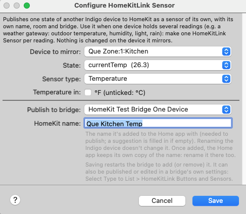
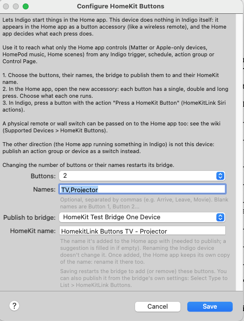
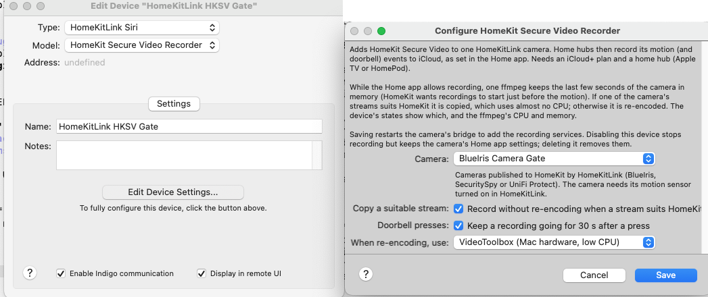

# HomeKitLink Devices

Besides bridges, HomeKitLink has three device types of its own. You create them in Indigo like any device: **New Device → Type: HomeKitLink Siri → Model:**

| Model | What it's for | Published to HomeKit? |
|---|---|---|
| [**HomeKitLink Sensor**](#homekitlink-sensor-v0837) | One state of another Indigo device as a HomeKit sensor of its own | Yes, as a sensor |
| [**HomeKit Buttons**](#homekit-buttons-v0827) | Lets Indigo start things in the Home app | Yes, as buttons |
| [**HomeKit Secure Video Recorder**](#homekit-secure-video-recorder-v0822) | Adds HomeKit Secure Video recording to one camera | No: it adds recording to a published camera |

None of them change the Indigo devices they work with.

---

## HomeKitLink Sensor (v0.8.37+)

**Publishes one state of another Indigo device as a HomeKit sensor of its own**, with its own name, room and bridge.

HomeKitLink publishes each Indigo device once, as one HomeKit type. Many devices hold several readings: a weather gateway (Ecowitt, Tempest, Netatmo) has outdoor and indoor temperature, humidity, light and rain; a thermostat zone has its own temperature. Make one HomeKitLink Sensor per reading and each becomes its own tile in the Home app, in whatever room you like.

### Settings

| Setting | Use |
|---|---|
| **Device to mirror** | Any Indigo device (HomeKitLink's own devices aren't listed) |
| **State** | The state to follow; its current value is shown next to it |
| **Sensor type** | Temperature, Humidity, Light (lux), Contact, Motion, Occupancy, Leak, Smoke, Carbon Monoxide, Carbon Dioxide, **Air Quality** (v0.8.71+), or **Copy value only** (v0.8.71+) |
| **Reading** | Air Quality only: PM2.5, PM10, VOC, NO2 or air quality index (US AQI). The Home app grades it Excellent to Poor. VOC and NO2 can be in µg/m³ or ppb |
| **Temperature in** | Temperature only: tick for °F |
| **Detected when the state** | On/off types only: *is true / on*, *is false / off*, or *equals a value* (then type the value, e.g. `rain`, `open`) |
| **Publish to bridge** | The bridge to publish it to, or *Not published* |
| **HomeKit name** | The name it's added to the Home app with |

**Copy value only** copies the state as it is, without a sensor type: a number to the sensor's value, true/false (on/off, yes/no) to its on/off. Publish it from a bridge's settings, with **Show All**, to choose its HomeKit type and state there.

For the on/off types, "true / on" also accepts `on`, `yes`, `1`, `open`, `detected`, `wet`, and any number above 0. **Contact: on = open.**

### How it works
- It's a real **Indigo sensor device** whose value follows the source state: copied on every change of the source, and when the sensor starts. So you can also use it in Indigo triggers and Control Pages.
- **Nothing is stored on the source device.**
- Published, it's an ordinary HomeKit sensor of its type.
- If the source device is deleted, or the state disappears or (for Temperature, Humidity, Light) isn't a number, the sensor shows an **error** state and the log says why, once.

### Example: an Ecowitt gateway
| HomeKitLink Sensor | Device to mirror | State | Sensor type |
|---|---|---|---|
| Garden Temperature | Ecowitt Weather | `outdoorTemp` | Temperature |
| Garden Humidity | Ecowitt Weather | `outdoorHumidity` | Humidity |
| Garden Light | Ecowitt Weather | `solarRadiationLux` | Light |
| Raining | Ecowitt Weather | `rainStatePiezo` | Leak (true / on) |

The gateway itself can still be published once, for example as an [Air Quality Sensor](Supported-Devices#air-quality-sensor-v0828) using its PM2.5 state.

---

## HomeKit Buttons (v0.8.27+)

**Lets Indigo start things in the Home app.** It does nothing in Indigo itself: it appears in the Home app as a button accessory, like a wireless remote, and **the Home app decides what each press does**. Use it to reach what only the Home app controls (Matter or Apple-only devices, music on HomePods, Home scenes) from any Indigo trigger, schedule, action group or Control Page.

> The other direction, the Home app running something in Indigo, isn't this device: publish an action group or device as a **switch**.

### Settings

| Setting | Use |
|---|---|
| **Buttons** | How many, 1–10 |
| **Names** | Optional, separated by commas (e.g. `Arrive, Leave, Movie`). Blank names are Button 1, Button 2… |
| **Publish to bridge** | The bridge to publish it to, or *Not published* |
| **HomeKit name** | The name it's added to the Home app with |

Changing the number of buttons or their names restarts its bridge.

### Using it
1. Create it, choose the buttons, names, bridge and HomeKit name, and save.
2. **In the Home app**, open the new accessory: each button has a **single**, **double** and **long press**. Choose what each one runs. Until you do, pressing it does nothing.
3. **In Indigo**, press a button with the action **Press a HomeKit Button** (under HomeKitLink Siri actions): choose the device, the button and the press.

The log shows each press (`Hall Buttons: 'Movie' single press sent to HomeKit`), and the device's states show the last button, press and time.

A physical remote or wall switch (WallMote, Fibaro Button, keypads) can be passed on to the Home app with a Buttons device too: see [Supported Devices → A physical remote or wall switch](Supported-Devices#a-physical-remote-or-wall-switch-in-the-home-app).

---

## HomeKit Secure Video Recorder (v0.8.22+)

Adds **HomeKit Secure Video** to one published camera (Blue Iris, SecuritySpy or UniFi Protect): home hubs record its motion and doorbell events to iCloud, as set in the Home app. One Recorder per camera, so recording, which runs ffmpeg around the clock, is always a deliberate choice for each camera. Its states show what it costs (ffmpeg CPU and memory) and what it's doing.

It isn't published itself. See [Camera Setup → HomeKit Secure Video](Camera-Setup#homekit-secure-video-v0822) for setup, costs and troubleshooting.

---

## Publishing HomeKitLink devices

HomeKitLink Sensors and HomeKit Buttons can be published in two places, which change the same settings, so you can publish, move or unpublish them from either:

- **In their own settings:** **Publish to bridge** and **HomeKit name**, then Save. The bridge restarts to add, move or remove it.
- **In a bridge's settings:** **Select Type to List → HomeKitLink Buttons and Sensors**, choose it, then **Save Device**, as for any device. They're also in **all Indigo Devices**.

**HomeKit name.** When you create a device, its settings open while it's still called "new device N" (Indigo applies the name you type afterwards), so the name HomeKit uses is set in the **HomeKit name** field. Leave it empty and HomeKitLink fills in a suggestion (e.g. "Ecowitt Weather Humidity") for you to check, then Save again. Renaming the Indigo device later doesn't change the HomeKit name. Once an accessory is in the Home app, the Home app keeps its own copy of the name: rename it there too.

**If its bridge is deleted**, its **Publish to bridge** menu shows it as *Bridge ID … (deleted)* rather than switching to *Not published*, so saving its settings doesn't unpublish it by accident. Move it to another bridge with the menu, or with the plugin menu **Move Accessories**.

→ [Supported Devices](Supported-Devices) · [Setup & Configuration](Setup-and-Configuration) · [Camera Setup](Camera-Setup)
