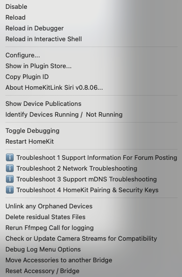
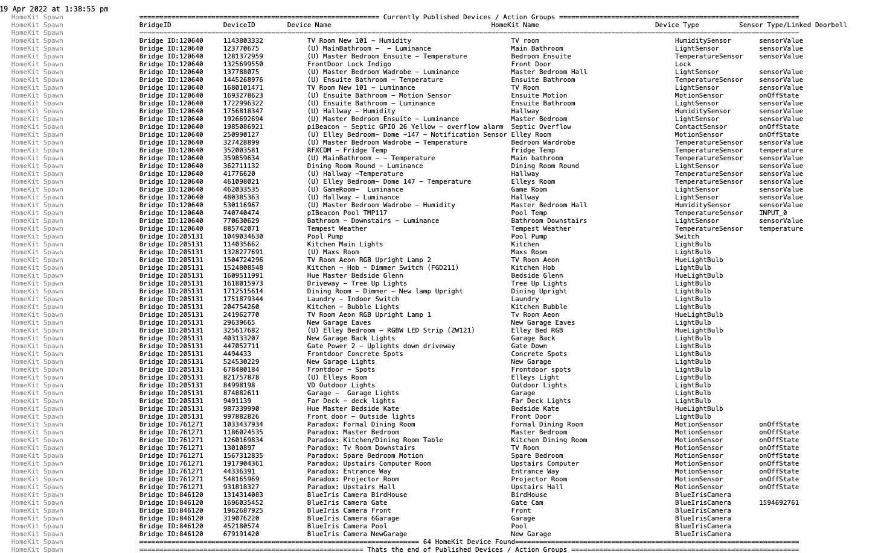
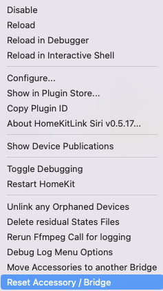

# Plugin Menu Items

All HKLS tools are available under **Plugins → HomeKitLink Siri** in the Indigo menu bar.



---

## ⭐ Troubleshoot Items — Run These First!

> **Before posting any issue on the forum, run the Troubleshoot items and include the output.**
> These tools diagnose the vast majority of connectivity, mDNS, and network issues automatically.

---

### ℹ️ Troubleshoot 1 — Support Information For Forum Posting

**Plugins → HomeKitLink Siri → ℹ️ Troubleshoot 1 Support Information For Forum Posting**

Generates a comprehensive summary of your HKLS installation for forum support. Output includes:

- Plugin version and Python version
- All configured bridges and their status
- Published device list
- mDNS / network configuration (IP version, interfaces, listen address, IPv6)
- Active driver count and port assignments
- Any known error conditions

**Use it for:** Any support request. Copy everything from the Indigo log and paste it into your forum post.

---

### ℹ️ Troubleshoot 2 — Network Troubleshooting

**Plugins → HomeKitLink Siri → ℹ️ Troubleshoot 2 Network Troubleshooting**

Performs a comprehensive network diagnostic. Checks:

- **macOS version, Python version, architecture**
- **Apple Local Network Access** — definitive multicast send test (catches LNA blocks that simpler tests miss)
- **mDNS Multicast Group Join** — verifies multicast socket can be opened
- **Outbound UDP connectivity** — tests internet reachability
- **Gateway reachability** — pings your local gateway
- **Firewall status** — checks `socketfilterfw` state, stealth mode, and block-all setting
- **Plugin network configuration** — shows advertised IP, server IP, IP version, interfaces, starting port, active bridges
- **Bridge port checks** — confirms each bridge's TCP port is accepting connections
- **DNS resolution** — checks DNS is working

Example output:
```
HomeKitLink Siri   ✅ Successfully sent multicast packet to 224.0.0.251:5353 via 192.168.1.6
HomeKitLink Siri      Local Network Access is ENABLED.
HomeKitLink Siri   ✅ Port 51840 is accepting connections.
HomeKitLink Siri   ✅ Port 51841 is accepting connections.
```

**Use it when:** Bridge not visible in Home app; HomeKit can't connect; after macOS upgrade.

> **macOS Sequoia (15.x+) users:** Run this to verify Local Network Access is granted to IndigoPluginHost3.

---

### ℹ️ Troubleshoot 3 — Support mDNS Troubleshooting

**Plugins → HomeKitLink Siri → ℹ️ Troubleshoot 3 Support mDNS Troubleshooting**

Focused mDNS/Bonjour diagnostic. Checks:

- Network interfaces and their IP addresses
- Firewall status as it relates to mDNS
- Zeroconf / AsyncZeroconf state
- Bonjour / mDNSResponder service status
- mDNS advertisement records for all active bridges
- Interface binding and IP version settings

**Use it when:** Bridge was previously visible but has disappeared from Home; HomeKit takes a long time to discover bridges; after changing network configuration or IP addresses.

---

### ℹ️ Troubleshoot 4 — HomeKit Pairing & Security Keys

**Plugins → HomeKitLink Siri → ℹ️ Troubleshoot 4 HomeKit Pairing & Security Keys**

Checks every bridge's HomeKit pairing and security keys: saved vs running keys, the Home users (Apple Accounts) paired with each bridge, which devices / Home hubs are connected, and any failed connection attempts. Ends with a clear ✅ / ⚠️ / ❌ verdict, a 🛠️ fix for each problem and a guide to common HomeKit issues.

The report has these sections:

- 🖥️ **System** — plugin / macOS version, state folder writable ✅
- 📋 **Bridge Summary** — one line per bridge: ✅ healthy, ⚠️ needs attention, ❌ problem, ⏸️ disabled
- 👥 **Home Users** — each person (Apple Account) paired with your bridges: 👑 owner / 👤 shared, and whether any are missing from some bridges
- 📡 **Connected Devices / Home Hubs** — which IPs are connected, and which is probably your Home hub
- 🔌 **Bridge Ports** (0.8.41+) — each bridge's port and whether it's its saved port; checks that `bridge_ports.json` is there, readable and has no two bridges on one port; ports kept for deleted bridges; and every Home device that reached the **wrong bridge** since plugin start (device, bridge it wanted, bridge it reached, how often, when). See [Troubleshooting → No Response on a whole bridge](Troubleshooting#no-response-on-a-whole-bridge-everything-works-from-indigo)
- 🔍 **Bridge Details** — one line for a healthy bridge; full detail and a 🛠️ fix for anything wrong
- 🩺 **Result** and 📖 **Common HomeKit Issues Explained**

Private keys are never logged and IDs are shortened, so the output is safe to post on the forum.

**Use it when:** A bridge won't add ("Accessory already added", "Setup code incorrect"); accessories show "No Response" and Troubleshoot 2 & 3 look fine (check 🔌 Bridge Ports); the log warns that a Home device reached the wrong bridge; the log shows a Home app client failing to verify; after restoring a backup or resetting a bridge.

> ℹ️ Failed connection attempts are recorded from plugin start.  If you are chasing a connection problem, open the Home app (or wait a few minutes) before running it.

---


## Show Device Publications

**Plugins → HomeKitLink Siri → Show Device Publications**

Lists all Indigo devices currently configured for HomeKit publishing in the Indigo log.



Status indicators:
- **Normal** — device is published and bridge is running
- **Warning** — bridge is disabled
- **Red** — bridge no longer exists (device is orphaned)

**Use it for:** Auditing which devices are published; identifying orphaned device references.

---

## Identify Devices Running / Not Running

**Plugins → HomeKitLink Siri → Identify Devices Running / Not Running**

Shows which HKLS bridge devices are currently running and which are stopped or disabled.

---

## Toggle Debugging

**Plugins → HomeKitLink Siri → Toggle Debugging**

Quickly toggles the main debug logging level on/off. More granular debug options are in Plugin Config (Configure…).

---

## Restart HomeKit

**Plugins → HomeKitLink Siri → Restart HomeKit**

Stops and restarts all HomeKitLink bridges. Use when:
- A bridge has stopped responding
- You've made configuration changes outside of the device config dialog
- After a network change that may have affected mDNS

---

## Unlink Any Orphaned Devices

**Plugins → HomeKitLink Siri → Unlink any Orphaned Devices**

Removes the HomeKit bridge association for any Indigo device whose bridge device has been deleted from Indigo. Cleans up stale references so those devices can be re-published to a new bridge.

---

## Delete Residual States Files

**Plugins → HomeKitLink Siri → Delete residual States Files**

Deletes any leftover HomeKit state files from deleted or reset bridges. Use when a bridge shows "needs to be reset" in the Home app after being deleted.

---

## Rerun FFmpeg Call for Logging

**Plugins → HomeKitLink Siri → Rerun Ffmpeg Call for logging**

Re-runs the last camera stream FFmpeg command and logs the full output. Useful for diagnosing:
- RTSP stream problems
- FFmpeg codec errors
- Network connectivity to the camera

---

## Check or Update Camera Streams for Compatibility

**Plugins → HomeKitLink Siri → Check or Update Camera Streams for Compatibility**

Runs `ffprobe` against all configured camera RTSP streams and logs compatibility analysis. Determines whether each stream can be passed through unchanged or needs transcoding.

**Run this after:**
- Changing Blue Iris stream / profile settings
- Adding a new camera
- Any change to camera resolution, codec, or frame rate

See [Camera Setup](Camera-Setup#camera-stream-intelligence) for example output.

---

## Debug Log Menu Options

**Plugins → HomeKitLink Siri → Debug Log Menu Options**

Opens a sub-dialog with detailed internal debug logging buttons:

| Button | Logs |
|---|---|
| Debug Log Internal List | HKLS internal device tracking list |
| Debug all Bridges | All bridge objects and their state |
| Debug Log Drivers | All HAP AccessoryDriver instances |
| Debug Log Threads | All running threads and their status |
| Debug Log Device List | Internal device mapping list |
| Debug all Accessories | All registered HomeKit accessories and characteristics |

Use these when investigating internal state issues — particularly useful when a device isn't updating correctly or a bridge appears stuck.

---

## Move Accessories to Another Bridge

**Plugins → HomeKitLink Siri → Move Accessories to another Bridge**

Copies all HomeKit accessories from one bridge to another. Enables recovery when:
- A bridge device was accidentally deleted
- You want to consolidate or reorganise bridges

> **⚠️ This operation carries some risk.** Use with caution and unpair the old bridge from the Home app first.

**Procedure:**
1. Select the **From Bridge** (source)
2. Select the **To Bridge** (destination)
3. Click **Move Accessories**
4. Unpair the old bridge from the Home app

---

## Make Home Re-read a Bridge's Accessories

**Plugins → HomeKitLink Siri → Make Home Re-read a Bridge's Accessories**

Raises the bridge's configuration number. Every home hub, iPhone and iPad then fetches the bridge's accessories again and drops any that are no longer published. Use it when:
- An accessory you removed is still in Home, as **No Response** (e.g. a camera shows an extra accessory)
- A home hub keeps putting back an old copy of an accessory: its settings revert, or a camera's recordings don't save

The bridge stays paired and keeps running. Nothing is unpublished: accessories keep their rooms, names, automations, settings and recordings.

**Procedure:**
1. Select the bridge (a camera's bridge is the one it's published to)
2. Click **Re-read Accessories**. The log confirms the new number
3. Give Home a few minutes, then check the Home app

---

## New HomeKit Identity for a Device (emergency)

**Plugins → HomeKitLink Siri → New HomeKit Identity for a Device (emergency)**

Gives one published device a **new accessory ID**. Home removes the old accessory, together with anything Home kept for it, and adds the device as a brand-new accessory.

Use it when Home keeps showing something that's no longer published, e.g. a camera's old control or sensor shown as **No Response**, and neither of these cleared it:
- **Make Home Re-read a Bridge's Accessories**
- Unpublishing and publishing again: that doesn't help, because the device comes back with the **same** accessory ID, and Home (or a home hub with an old copy) matches it to its old record

| Kept | Starts again in the Home app |
|---|---|
| The bridge, its pairing and its other accessories | The device's room and name |
| The device's HomeKitLink settings | Automations and scenes that use it |
| A camera's HKSV Recorder and its settings | Notifications, and a camera's Recording Options |
| | A camera's recordings (deleted) |

**Procedure:**
1. Choose the **Device**. The list shows each published device with its bridge
2. Tick **Confirm**, then click **Make New Identity**. The log shows the old and new accessory IDs
3. Its bridge restarts. In the Home app, the device appears as new in the bridge's room: set its room, name and settings again (for a camera, Stream & Allow Recording)

Each press makes another new identity, so the tick is cleared after each one.

> Unpublishing a device and publishing it again also gives it a new identity (from 0.8.59), so use this menu item when the device should stay published.

---

## Reset Accessory / Bridge

**Plugins → HomeKitLink Siri → Reset Accessory / Bridge**



Deletes the security keys and pairing information for a selected bridge. Use when:
- A bridge shows "This accessory needs to be reset" in the Home app
- You tried to pair a bridge and it failed or was cancelled, leaving it in a broken state

**Correct procedure:**
1. **Delete the bridge from the Home app first**
2. Select the bridge in this menu
3. Click **Reset Bridge Accessories**
4. Restart the HKLS plugin
5. Re-add the bridge using the QR code

> **⚠️ Do not reset a bridge that is successfully paired in the Home app** — this breaks the existing pairing. You would need to re-pair from scratch.

---

→ [Troubleshooting](Troubleshooting) — full troubleshooting guide
