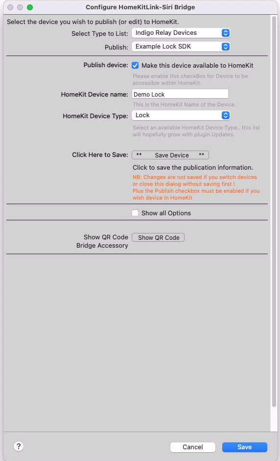
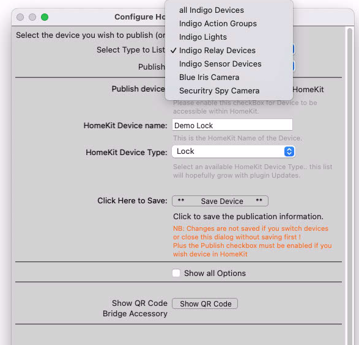
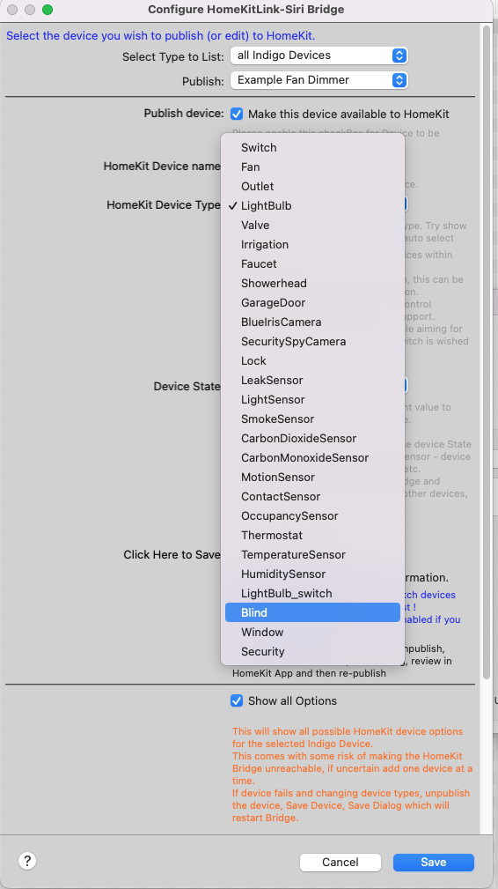
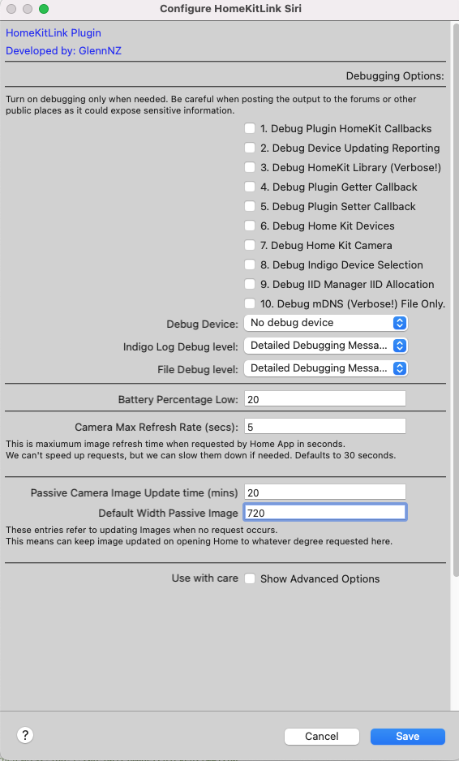
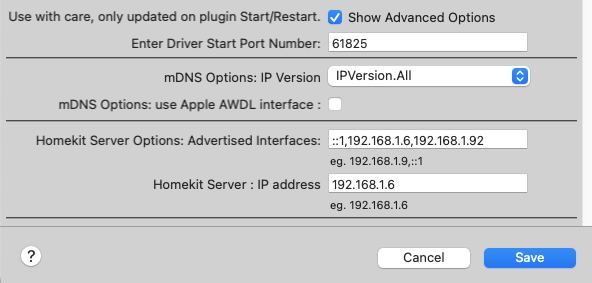

# Setup & Configuration

---

## Bridge Device Configuration

Each **HomeKitLink Bridge** device has a config dialog with all the tools needed to manage published accessories.

### Finding a device

The top of the bridge dialog finds the device to publish (or edit):

1. **Select Type to List** narrows the list:

   | Entry | Lists |
   |---|---|
   | **all Indigo Devices** | Every device (except HomeKitLink's own bridges and HKSV Recorders, which can't be published) |
   | **Indigo Action Groups** | Action groups |
   | **Indigo Lights / Relay Devices / Sensor Devices** | Dimmers and lights, relays, sensors |
   | **Indigo Thermostats / Fans (Speed Control) / Sprinklers** | Those device kinds |
   | **Plugin Devices** | Every third-party plugin's devices, under a heading per plugin |
   | **Cameras (all)** | Blue Iris, SecuritySpy and UniFi Protect cameras, under a heading each (each also has its own entry) |
   | **HomeKitLink Buttons and Sensors** | HomeKitLink's own [HomeKit Buttons and HomeKitLink Sensor devices](HomeKitLink-Devices) |

2. **Search**: type part of a name, or several words in any order, and press **Find**; the list shows only matching devices. **Clear** shows them all again. (Pressing Return in the box is the dialog's Save: it applies the search and keeps the dialog open; press Save again to save and close.)
3. **Device to Publish**: the list, in three parts: devices available to publish, devices on **this** bridge, and devices on **other** bridges (greyed out, with the bridge's name: edit that bridge to change them). Each part is sorted by name, ignoring capitals and with numbers in order.

A device's options (Publish, HomeKit name, type and the type's settings) appear once a device is chosen.

---

### Show All Options

The **Show All Options** checkbox unlocks every HomeKit device type for the currently selected Indigo device. By default HKLS restricts the type list to sensible choices for the device category.

> **⚠️ Use with care.** Selecting an incompatible type (e.g. trying to use a temperature sensor as a camera) can cause the bridge to fail. If a bridge stops responding after a type change, see [Troubleshooting](Troubleshooting).

---

### Published Device List

The device list shows:
- **Normal text** — devices published to *this* bridge
- **Greyed-out** — devices published to *another* bridge (you must edit that bridge to change them)

---

### Supported HomeKit Types

HKLS automatically selects the best HomeKit type for a device. You can override this with Show All Options. See [Supported Devices](Supported-Devices) for the full list.

---

### Sensor Device State Selection

When publishing a sensor device, HKLS asks which **device state** to use as the sensor value:

- For most sensors: **`sensorValue`** (the standard Indigo sensor value)
- For plugin devices (piBeacon, RFXCOM, etc.): choose the state that matches the data type
- The config menu shows the **current value** of each state to help you choose

**Type requirements:**
- On/Off sensors (motion, occupancy, contact): must be `true`/`false`
- Temperature / humidity: must be a plain number — `22.1`, not `"22.1°C"`

If a device sends the wrong type, HKLS will display `0` or may cause the bridge to stall. Fix by unpublishing the device (uncheck Publish, Save) and reconfiguring.

> One device with several readings (e.g. a weather gateway)? Publish the device once, and use a [HomeKitLink Sensor](HomeKitLink-Devices#homekitlink-sensor-v0837) for each extra reading.

---

### Saving, and what's stored on your devices

- Changes to a device are saved with **Save Device**. Closing the bridge dialog with its own Save doesn't save the device you were editing.
- HomeKitLink stores a device's publishing settings on the device itself: published, bridge, HomeKit type, HomeKit name, and only the settings its HomeKit type uses (v0.8.36+). Changing a device's type drops the old type's settings.
- **Unpublishing** a device (untick Publish, **Save Device**) removes all of HomeKitLink's settings from it.
- **Deleting or disabling a bridge** doesn't change its devices: they keep their settings, and can be moved to another bridge with the plugin menu **Move Accessories**.

---

## Plugin Config

Open via **Plugins → HomeKitLink Siri → Configure…**

### Debug Options

| Option | Description |
|---|---|
| **1. Debug Plugin HomeKit Callbacks** | Verbose HAP callback logging |
| **2. Debug Device Updating Reporting** | Log every device state update sent to HomeKit |
| **3. Debug HomeKit Library (Verbose!)** | Full `pyhap` library debug — very noisy |
| **4. Debug Plugin Getter Callback** | Log every HomeKit property read |
| **5. Debug Plugin Setter Callback** | Log every HomeKit property write |
| **6. Debug HomeKit Devices** | Device-level HomeKit state tracing |
| **7. Debug HomeKit Camera** | Camera stream debug |
| **8. Debug Indigo Device Selection** | Device list / filter debug |
| **9. Debug IID Manager** | HomeKit IID allocation tracing |
| **10. Debug mDNS (File Only!)** | Very verbose mDNS/Bonjour log — written to file only, not Indigo log |
| **11. Debug Actions** | Action group triggering debug |
| **Debug Device** | Select a single Indigo device to trace — useful for isolating one problematic device |

> **⚠️ Only enable debug levels you actually need.** Debug 3 (HomeKit Library) and Debug 10 (mDNS) are extremely verbose. Debug 10 goes to file only to avoid flooding the Indigo log.

---

### Camera Settings

| Setting | Description |
|---|---|
| **Camera Max Refresh Time** | Maximum seconds between camera image refreshes. Default: 30s. Lower = higher CPU usage. |
| **Passive Camera Update Image Time** | How often HKLS updates the stored image buffer when the Home app is NOT actively viewing. Prevents stale snapshots (e.g. 1 hour = image is at most 1 hour old when you reopen the app). |
| **Image Width** | Width of the snapshot image requested from the camera. |
| **BlueIris Remote Viewing Stream** | Blue Iris stream used away from home (mobile data), sized and limited to what HomeKit asks for. Stream 0 (default), Stream 1, or Off. Checked at plugin start; at home Stream 2 is always used. See [Remote / Mobile Viewing](Camera-Setup#remote--mobile-viewing--blue-iris-v0809). Restart the plugin after changing. |

---

### Advanced mDNS / Networking Options

See [Advanced Configuration](Advanced-Configuration) for full details.

---

## Bridge Limits

| Limit | Value |
|---|---|
| Devices per bridge | Up to **95** |
| Bridges per plugin | **Unlimited** |
| Device per plugin total | Effectively unlimited (multiple bridges) |

**Tip:** Some users create one bridge per room, or one bridge per device type. There's no right answer — do whatever makes management easiest. Avoid creating bridges you don't need, but multiple bridges add only modest overhead.

---

## Changing a Device's HomeKit Type

> **Important:** Changing a device from one HomeKit type to another (e.g. Switch → Blind) requires a specific sequence:
>
> 1. **Uncheck Publish** for the device — click **Save Device**
> 2. Click **Save** in the dialog (restarts the bridge)
> 3. **Verify** in the Home app that the old accessory has disappeared
> 4. Re-open the bridge config → re-add the device with the new type
> 5. Click **Save** again
>
> Skipping this causes HomeKit to retain the old device type, leading to control failures.

---

## Duplicate Devices in HomeKit

An Indigo device can only be published to **one** HKLS bridge at a time. If you need the same physical device to appear under two different names in HomeKit (e.g. "Bedroom Light" and "Upstairs Light"):

- Use the **Masquerade** plugin, or
- Create an Indigo **Virtual Device** that mirrors the original

Both approaches create a second Indigo device that HKLS can publish independently.

---

→ [Supported Devices](Supported-Devices) — see all HomeKit accessory types
