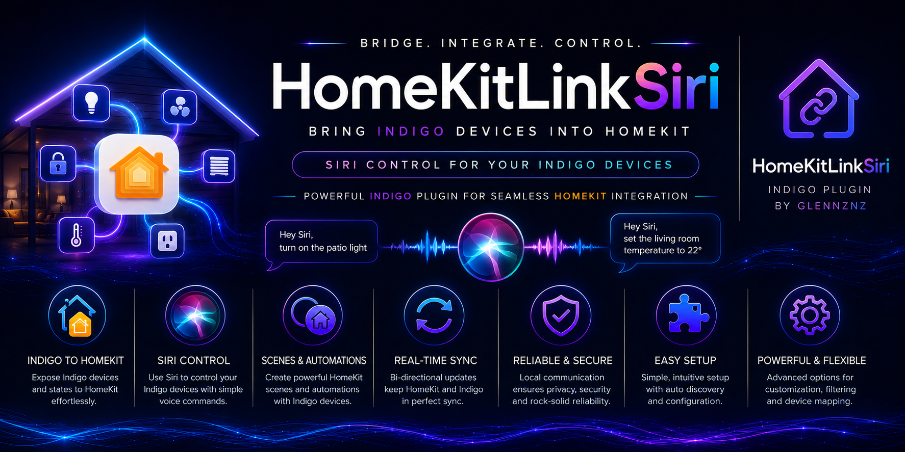

# Supported Devices

HKLS supports a wide range of HomeKit accessory types. Everything is user-selectable — with **Show All Options** enabled you can technically assign any HomeKit type to any Indigo device, though sensible defaults are pre-selected for you.

---

## Lights

### Lightbulb

**Best choice for all light devices.**

HKLS automatically detects the correct subtype:

| Subtype | Triggered by |
|---|---|
| **Colour bulb** | Device supports RGB / Hue |
| **Colour temperature bulb** | Device supports colour temperature |
| **Dimmable bulb** | Device is a dimmer |
| **Switch bulb** | Simple on/off only |

> Use **Lightbulb_switch** if you want a simple on/off switch in HomeKit even when the physical device supports dimming.

Within the Home app, lights can be grouped into a single accessory tile.

---

## Fans

### Fan (Simple)

For a basic on/off fan — no speed control.

### Fan V2

For fans with speed control. HKLS auto-selects Fan V2 if the Indigo device is a **Speed Control** device or has a brightness/level state.

> **Tip:** Any switch can be displayed as a Fan icon in the Home app without changing the device type — just tap the icon in Home and change the appearance.

---

## Switch / Outlet

**Simple on/off device.** Works with any Indigo relay device.

- **Action Groups** default to the Switch type
- Within HomeKit, a Switch can be displayed as a **Switch**, **Fan**, or **Outlet** — change the icon in the Home app without reconfiguring HKLS

---

## Sensors

All sensors follow the same pattern: HKLS reads a selected **device state** and maps it to the HomeKit sensor value. The state is chosen when you configure the device.

> **State requirements:**
> - On/Off sensors: state must be `true`/`false`
> - Numeric sensors (temperature, humidity, luminance): state must be a **plain number** — no units suffix

### Motion Sensor
Triggers HomeKit automations and notifications when motion is detected.

### Occupancy Sensor
Reports presence/absence. Verified working with the **Occupatum** plugin and any true/false on/off state device.

### Contact Sensor
Reports open/closed state — doors, windows, drawer contacts.

### Temperature Sensor
Reports temperature in **Celsius**. HomeKit displays in the user's preferred unit. Ensure the state value is a plain number (`22.1`, not `"22°C"`).

### Humidity Sensor
Reports relative humidity (0–100%).

### Luminance / Light Sensor
Reports lux. HKLS includes a check for abnormally high lux values (>100,000).

### Smoke Sensor
Binary smoke detected / not detected.

### Carbon Monoxide Sensor
Binary CO detected / not detected.

### Air Quality Sensor (v0.8.28+)
The Home app's air quality tile, from any device that measures air quality (e.g. Awair, PurpleAir or AirVisual plugins). When publishing, choose the state that holds each reading the device has, and leave the rest **Not used**:

| Reading | Units | Rated by |
|---|---|---|
| PM2.5, PM10 | µg/m³ | US EPA AQI bands |
| VOC | µg/m³ or ppb | WHO indoor air guidance |
| NO2 | µg/m³ or ppb | WHO guidance |
| Ozone | µg/m³ or ppb | US EPA AQI bands |
| CO2 | ppm | shown, not rated |
| Air quality index | US AQI 0–500 | its own bands |

The Home app shows each reading and an overall rating, **Excellent → Poor**, which is the worst of them (the same bands Home Assistant uses). Set **VOC, NO2 and ozone are in** to ppb if your device reports parts per billion; they're converted for HomeKit (VOC by a typical indoor factor of 4.5, so ratings are approximate).

Devices with states named like `pm25`, `pm10`, `voc`, `no2` or `aqi` are offered Air Quality Sensor automatically with those states pre-selected (live readings rather than averages or batteries); check them before saving. Example: an **Ecowitt gateway** with a PM2.5 sensor: PM2.5 = `pm25Ch1`, everything else Not used. HomeKit shows densities up to 1000 µg/m³.

### Leak Sensor
Binary leak detected / not detected.

### Battery Service
All sensor types automatically expose a battery level characteristic. Configure the **Low Battery Alert** threshold in Plugin Config.

---

## Blinds & Windows

### Blind / Window Covering

Supports both on/off devices (open/closed) and dimmer devices (position 0–100%).

**Inversion options** (configurable per device):
- **Reverse open/close logic** — treat On as Closed, or On as Open
- **Reverse position** — treat 20% as 80% open (or vice versa)

### Window

Same as Blind but displayed as a Window in HomeKit.

---

## Thermostat

Largely supported. Supports:
- Current temperature reporting
- Target temperature setting
- Heating / Cooling / Auto / Off modes
- Setpoint heat and cool managed independently when mode changes
- Temperature unit conversion (plugin converts non-Celsius devices for HomeKit)

> Some fine-tuning may still be needed for complex multi-zone setups.

### Heater-Cooler (v0.8.29+)

The Home app's **air conditioner** tile, for split systems, ducted ACs and heat pumps. Choose **HeaterCooler** instead of Thermostat when publishing an Indigo thermostat.

| | Thermostat | Heater-Cooler |
|---|---|---|
| On / off | "Off" is one of the modes | A power button; turning on resumes the last mode |
| Modes | Off, Heat, Cool, Auto | Heat, Cool, Auto |
| Targets | One target (a range in Auto) | Heat and cool targets |

Actron Que devices (main unit and zones) default to HeaterCooler (v0.8.30+); devices already published keep their type.

**Zones** (e.g. Actron Que zones, which are Indigo thermostats of their own): publish each zone you want in the Home app separately, each with **Zone of** set to its main unit. Leave the main unit itself as *Not a zone*. It's filled in automatically for Actron Que zones.

- A zone's **power button** only opens or closes that zone. Turning a zone on while the main unit is off opens the zone but doesn't start the unit.
- A zone **shows the main unit's mode** and never changes it. Changing the mode on a zone's tile is ignored (the log says so); change it on the main unit.
- Each zone has its **own targets**. If the zone has minimum and maximum setpoint states (Actron zones do, and they move with the main unit's setpoint), a new target is kept within the range at that moment and the tile shows where it landed. The log says when a target was adjusted.

So "Hey Siri, turn on the kitchen air conditioner" opens the kitchen zone.

**Other thermostat and AC plugins** work the same way, through Indigo's standard thermostat commands:

- The tile only offers what the device supports: a cooling-only AC gets Cool (and no heat target), a heating-only one Heat; Auto needs both.
- A device whose plugin doesn't allow mode changes keeps its tile's power and mode as Indigo reports them (the log says why); its targets can still be set.
- Fan-only and dry modes have no HomeKit equivalent. Indigo plugins usually report them as another mode or Off, and the tile shows that.
- A scheduled ("program") mode shows as its plain mode; changing the mode from Home sets the plain mode, as Thermostat does.
- ACs with a single target temperature: Home sets the cool target in Cool and the heat target in Heat, so it depends on the plugin using the right one for the mode (most do).
- Wall thermostats for central heating and cooling are usually better left as **Thermostat**.

The tile shows **heating / cooling / idle** from the thermostat's *heater on* / *cooler on* states. A thermostat plugin that doesn't set them shows idle while running.

---

## Locks

Standard HomeKit lock — reports locked/unlocked state and accepts lock/unlock commands.

---

## Garage Door

Supports Garage Door state and open/close commands. MultiIO Insteon garage door devices are supported.

---

## Valve / Irrigation / Shower Head

Valve-type accessories supporting on/off. Tested and working; there is a known occasional Home app display refresh delay (opening the device tile forces a state refresh).

---

## Robot Vacuum / Lawn Mower (v0.8.27+)

HomeKit has no vacuum or mower tile for bridged devices (Apple's robot vacuum support is for Matter devices only), so these show as a **switch**, as Home Assistant does: **on starts it, off sends it home**. Siri: "turn on the vacuum".

When publishing, choose type **Vacuum** or **LawnMower**, then:

| Setting | Use |
|---|---|
| **Start** | An action group to start it, or leave as *turn the device on* |
| **Stop / go home** | An action group to send it home, or leave as *turn the device off* |
| **Running when** / **is one of** | The state that shows it's working and its values, separated by commas (e.g. `status` is one of `cleaning, spotCleaning`). Leave blank to use the device's on/off |

---

## HomeKitLink Sensor (v0.8.37+)

Publishes **one state of another Indigo device as a HomeKit sensor of its own**: its own name, room and bridge. Use it when one device holds several readings, for example a weather gateway (Ecowitt, Tempest, Netatmo) with outdoor temperature, humidity, light and rain. HomeKitLink publishes each Indigo device once; a HomeKitLink Sensor per reading gives each its own tile in the Home app. **Nothing is changed on the device it mirrors.**

1. Create a new device: Type *HomeKitLink Siri*, Model **HomeKitLink Sensor**.
2. Choose the **Device to mirror**, its **State**, and the **Sensor type**:

   | Sensor type | The state should be | In HomeKit |
   |---|---|---|
   | Temperature | a number (tick °F if it's Fahrenheit) | Temperature |
   | Humidity | a number, % | Humidity |
   | Light | a number, lux | Light level |
   | Contact, Motion, Occupancy, Leak, Smoke, CO, CO2 | on/off, true/false, or a value | Detected / not detected (Contact: on = open) |

   For the on/off types, **Detected when the state** is true/on, false/off, or **equals a value** you type (e.g. `rain`, `open`).
3. **Publish to bridge**: choose the bridge, and give it a **HomeKit name**, the name it's added to the Home app with. Leave it empty and HomeKitLink suggests one (e.g. "Ecowitt Weather Humidity") for you to check before saving again. Or publish it from a bridge's settings (**Select Type to List → HomeKitLink Buttons and Sensors**).

> The HomeKit name is separate from the Indigo device name: a new device is still called "new device N" while its settings are open, so the HomeKit name is set here. Once added, the Home app keeps its own copy of the name; rename it there too if you change it later.

It's an ordinary Indigo sensor that follows its source state, so you can use it in Indigo triggers and Control Pages too. If the mirrored device is deleted, or the state disappears or isn't a number, the sensor shows an error and the log says why.

---

## HomeKit Buttons (v0.8.27+)

**Indigo → Home.** A HomeKit Buttons device lets Indigo start things in the Home app. It does nothing in Indigo itself: it appears in the Home app as a button accessory (like a wireless remote), and **the Home app decides what each press does**.

Use it to reach what only the Home app controls (Matter or Apple-only devices, music on HomePods, Home scenes) from any Indigo trigger, schedule, action group or Control Page.

> The other direction, **Home → Indigo**, is an action group (or device) published as a **switch**.

### Setting it up

1. **Create** a new device: Type *HomeKitLink Siri*, Model **HomeKit Buttons**. Choose how many buttons (1–10) and, optionally, their names separated by commas (`Arrive, Leave, Movie`).
2. **Publish** it, either way:
   - in the device itself: **Publish to bridge** → choose the bridge, then Save (the bridge restarts to add it), or
   - in the bridge's settings like any other device: **Select Type to List** → **HomeKitLink Buttons**, then pick it.

   Both change the same setting, so you can later move or unpublish it from either place.
3. **In the Home app**, open the new accessory. Each button has a **single**, **double** and **long press**: choose the scenes or accessories each one runs. Until you do, pressing it does nothing.
4. **In Indigo**, press a button with the action **Press a HomeKit Button** (under HomeKitLink Siri actions): choose the device, the button and the press.

The log shows each press sent (`Hall Buttons: 'Movie' single press sent to HomeKit`), and the device's states show the last button, press and time, for use in Indigo triggers or Control Pages. Changing the number of buttons or their names restarts its bridge.

### A physical remote or wall switch in the Home app

The remote itself isn't published to HomeKit. Indigo already decodes its presses and turns them into **Indigo triggers**, for example the Z-Wave triggers "button 2 pressed received" or "button 2 double tap received" on a WallMote or Fibaro Button. A HomeKit Buttons device passes those presses on to the Home app.

1. **Make a HomeKit Buttons device** with one button per remote button: a 4-button WallMote Quad gets 4 buttons, a single Fibaro Button gets 1. Name them to match (e.g. `Top left, Top right, Bottom left, Bottom right`) so they're easy to recognise in the Home app.
2. **Publish it** to a bridge.
3. **For each press you want in Home**, open the remote's Indigo trigger (or create one: a Z-Wave *Command Received* trigger for the remote and that press) and add the action **Press a HomeKit Button**, choosing this Buttons device, the matching button and the press:

   | On the remote (Indigo trigger) | Press a HomeKit Button |
   |---|---|
   | button pressed | Single press |
   | double tap | Double press |
   | held | Long press |

4. **In the Home app**, open the Buttons accessory and choose what each press does.

You only need triggers for the presses you actually use. The same trigger can still do things in Indigo as well; the action just adds the Home app on top.

HomeKit buttons have only single, double and long presses, so a triple tap (or more) can't be passed on; keep those for Indigo-only actions. The same approach works for any remote Indigo understands (Z-Wave, Insteon keypads and remotes, or a plugin's button devices), as long as each press can start an Indigo trigger.

---

## Outlet

Same as Switch but displayed with an outlet icon in HomeKit.

---

## Security System

Security systems are a special case — there is no direct Indigo equivalent. HKLS implements a flexible mapping layer.

**Currently supported alarm panels:**
- **Paradox / Magellan / SP7000**
- **DSC Keypad**
- **VSS** (basic security system device)
- **AD2USB** (beta support)

HomeKit security states: Disarmed, Armed Stay, Armed Away, Armed Night, Triggered.

> Testing security systems is difficult without the actual hardware. If you have a supported system and encounter issues, please report on the forum with the [Troubleshoot menu output](Plugin-Menu-Items#troubleshoot-items).

---

## Cameras

Camera support is a major feature. See the dedicated [Camera Setup](Camera-Setup) page for full configuration details.

**Supported camera integrations:**
- **Blue Iris** (via the Blue Iris Indigo plugin) — full support including motion detection, doorbell, Opus audio, stream intelligence
- **SecuritySpy** (via FlyingDiver's SecuritySpy plugin) — live stream, doorbell, Opus audio, motion events
- **UniFi Protect** (via the Durosity UniFi or kw123 uniFiAP plugin) — live stream, doorbell, Opus audio, motion events

**Camera features:**
- Live RTSP → HomeKit stream transcoding / passthrough
- Opus audio proxy (RTP/SRTP clock-rate translation for HomeKit compatibility)
- Doorbell integration — any on/off Indigo device can trigger a HomeKit doorbell notification with live camera feed
- Motion sensor — BI cameras register as HomeKit motion sensors; act on motion events in the Home app

---

## Action Groups

All Indigo action groups are automatically available as **Switch** type accessories. Use the Home app icon picker to display them as Switch, Fan, or Outlet as appropriate.

---

## Device Compatibility Notes

| HKLS Behaviour | Why |
|---|---|
| Greyed devices in config list | Already published to another bridge — edit that bridge to manage them |
| Wrong state type → shows 0 | Temperature/humidity state must be a plain number |
| Bridge fails after Show All | Incompatible type selected — unpublish all devices, check logs, re-add carefully |
| Duplicate device needed | Use Masquerade plugin or Indigo Virtual Device |

---

→ [Camera Setup](Camera-Setup) — configure BlueIris, SecuritySpy and UniFi Protect cameras
